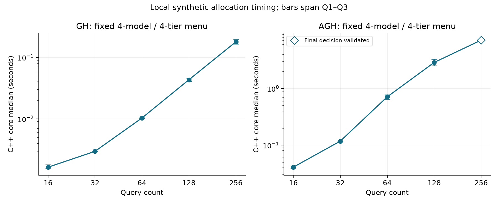
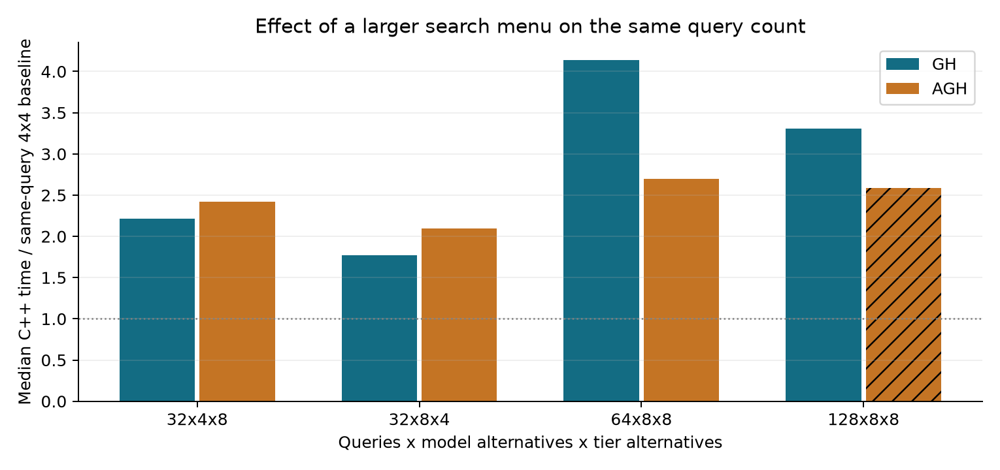
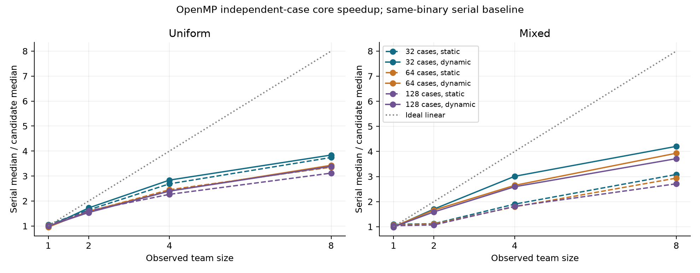
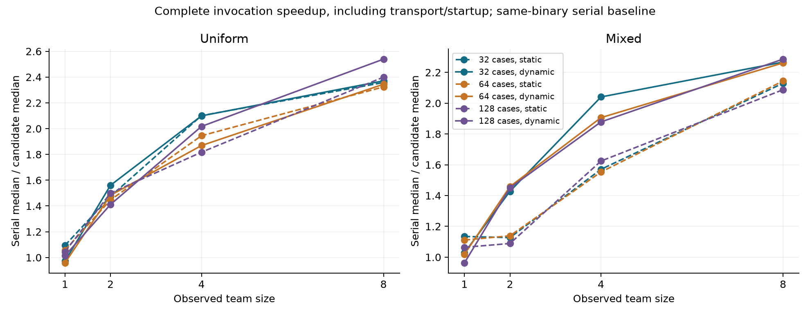

# Larger instances and measured parallelism

The performance extension asks where allocation planning becomes expensive and
which execution boundary benefits from parallelism. It grows the query count,
then the model/tier menu, and finally the batch of independent allocation cases.
Each comparison retains the verified scientific algorithms and numerical policy.

The October 13, 2026 run attempted all **12 timing jobs**: ten completed, and
two full AGH Python references failed with `MemoryError`. Finished GH methods
in those workers were retained; two separate native checks supplied the missing
AGH timing points with independent final-decision validation. The resulting
18 method/shape rows contain **90 individual native samples**. Sixteen complete
Python reference comparisons check **185,832 numeric values with zero bitwise
differences**. The 40 Stage-2 stress jobs remain outside this analysis.

| Observation | Measured value | Scope |
|---|---:|---|
| AGH at 128x4x4 | **2.889 s** native median; **340.978 s** Python check | Full reference comparison; timer scopes differ |
| AGH at 256x4x4 | **7.156 s** native median | Independent final-decision validation; full Python reference failed |
| AGH at 128x8x8 | **7.471 s** native median | Independent final-decision validation; full Python reference failed |
| Best observed OpenMP median speedup | **4.20x** core; **2.27x** complete invocation | 32 mixed cases, dynamic schedule, eight observed threads |
| Efficiency at that setting | **52.5%** | Median core speedup divided by observed team size |

The run uses an Intel Core i7-13620H host with 16 reported logical CPUs,
Windows 11/WSL2, GCC 13.3.0 and Python 3.14.3. The recorded power scheme is
Balanced; power observations during the reference run and after collection
show AC supply. OS activity and thermal conditions can affect these local timings.

The [measured tables](../benchmarks/performance_2026-10-13/analysis/report.md),
[machine-readable analysis](../benchmarks/performance_2026-10-13/analysis/analysis.json)
and [serial CSV](../benchmarks/performance_2026-10-13/analysis/serial_timings.csv)
are derived from retained evidence. Their coverage table distinguishes completed,
timed-out and unexecuted jobs; a missing measurement has no invented value.

## What grows

Shapes mean **queries x model alternatives x GPU-tier alternatives**, not GPU
devices deployed. The nine serial shapes are 16/32/64/128/256 x4x4, 32x8x4,
32x4x8, 64x8x8 and 128x8x8. Query-only growth and same-query menu controls expose
different sources of work. The new menu entries are synthetic interpolations,
not measurements of additional commercial GPUs.

All cases use coherent V2 costs, one-hour data residency, arrival multiplier
200, GH beta 0.8 and AGH seed 37. GH and AGH share identical serialized instance
inputs. Where the complete Python reference finishes, it verifies the method
before five individual C++ calls are measured. Objective/routing/placement
numeric values are compared bitwise, with independent scientific feasibility retained.

The 256x4x4 AGH reference encountered `MemoryError` while constructing validation
evidence. Its failure log and already verified GH measurements are retained.
Supplemental native measurements decode the supplied final C++ decision and
apply the same Python independent validator, with bitwise objective agreement.
They establish final-decision feasibility; their verification label explicitly
leaves full Python algorithm/transition parity unchecked. No completed Python
time or Python/C++ time ratio is supplied for a failed full reference.



Median durations and Q1–Q3 bars describe the five native samples. The analysis
also retains minima and interquartile ranges. An empirical exponent between the
first and last tested query-only size describes those observed endpoints; it
does not establish a formal complexity bound or extrapolate to other workloads.



Each menu-growth ratio uses the **same query count** at 4 models/4 tiers as its
baseline. Increasing queries changes workload; increasing alternatives changes
the search/validation space. Absolute modeled cost across sizes is consequently
not a pure measure of allocation quality.
Hatched bars identify supplemental final-decision validation; complete-reference
and supplemental points remain labeled in the underlying table.

## The three timers

| Timer | Includes | What its ratio supports |
|---|---|---|
| C++ core | GH/AGH computation, trace creation and independent native validation | Local implementation timing on the recorded inputs |
| Complete native invocation | Core plus process startup, WSL transport, parsing and output | End-to-end software invocation benefit |
| Python reference check | Python algorithm, projection and independent/reference comparison | One observed reference workflow, with a different scope |

The full Python timer is measured once per successfully completed method/shape. Ratios against C++ medians
are implementation comparisons, not an isolated effect of the programming
language. Benchmark preparation, repeated checks and evidence I/O are separate
from the reported core timer.

## Independent-case OpenMP scaling

The batches contain 32, 64 or 128 cases. Uniform batches use 16x4x4 AGH cases;
mixed batches cluster expensive 16x4x4 AGH cases before smaller 8x4x4 AGH/GH
cases. This makes load balance observable. Seeds start at 37 and increment by
case index. All schedules execute the same ordered input manifest and retain
serial acceptance/early-stopping semantics inside each case.

Each batch uses serial, static and dynamic schedules with requested teams
1/2/4/8. Eighteen rounds rotate and reverse setting order; actual team sizes are
recorded. Full scientific outputs are checked before measurement, and timed
compact outputs retain checked status, feasibility and objective. Algorithm and
validation work still executes when transport is compact.



Median core speedup is `serial median / candidate median` using the serial
schedule in the **same OpenMP-linked executable**. Efficiency divides that
speedup by the observed team size. It measures throughput of independent cases;
it does not accelerate a single GH/AGH solve.



The complete-process comparison keeps startup and transport visible. Core and
process gains are separate indicators. The full setting table accompanies any
highlighted best observed setting; local minima/medians and IQRs do not imply
statistical confidence or universal hardware scaling.

## Reproduce and inspect

Windows preparation uses the [overnight guide](NIGHTLY_CAMPAIGN.md). Execute
only the timing subset in a separate output directory:

```powershell
python scripts/run_performance_campaign.py --prepared results/nightly_campaign --output results/performance_run --wsl Ubuntu
```

Add `--resume` to continue unfinished timing jobs. Linux omits `--wsl`. The
original prepared 52-job campaign is preserved; the 40 Stage-2 stress jobs are
outside this timing subset. Native/Python programs are reused from the verified
snapshot; scientific sources, inputs and binaries are hashed.

If a full reference has recorded `MemoryError`, resume with
`--defer-known-memory-errors` to preserve that failed job and run the other
declared jobs. The failure remains in coverage. Finished methods inside a
stopped worker require matching input, golden, native-evidence and sample
digests before their measurements are included.

The separately labeled `profile_native_validated_instances.py` command measures
only native execution with Python final-decision validation. It does not relax
constraints, repair supplied auxiliaries or rerun an unexecutable full Python
heuristic. Such supplemental records remain distinct from complete reference
comparisons in the measured tables.

Regenerate analysis and figures from the shipped observations without rerunning
the algorithms:

```powershell
python -m zipfile -e benchmarks/performance_2026-10-13/evidence.zip results/performance_recorded
python scripts/analyze_performance_campaign.py --campaign results/performance_recorded --output results/performance_analysis
python scripts/plot_performance_campaign.py --analysis results/performance_analysis/analysis.json --output results/performance_analysis/plots
```

Plotting requires the optional `plots` extra. Raw evidence includes source and
binary hashes, runtime metadata, input transports, Python goldens, native
evidence and timing samples. The original measured scientific sources are
archived separately. Portable metadata replaces local paths with symbolic
locations; [provenance](../benchmarks/performance_2026-10-13/provenance.json)
retains original and exported digests. Numeric observations remain unchanged.

These are synthetic local CPU/WSL allocation measurements, not actual GPU
inference latency, observed cloud billing or a recovered paper experiment.
