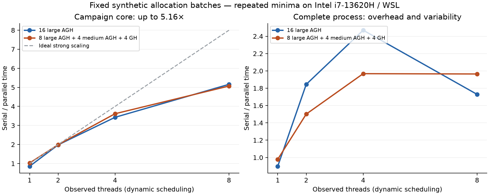
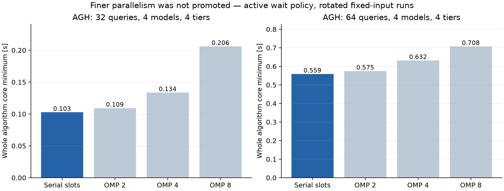
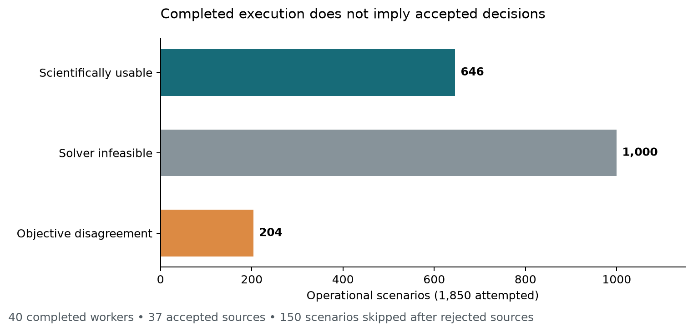

# Results and experimental scope

The repository evaluates allocation quality, agreement between implementations,
and the CPU time needed to plan allocations. Python/Pyomo provides the
scientific reference for the deterministic `P_DM` and Stage-2 optimization
problems; Python and C++20 implement the GH/AGH heuristics. OpenMP runs campaigns
of independent allocation cases. [MODEL.md](MODEL.md) separates the paper's
formulation from the project's explicit interpretations and implementation.

The experiments reported here use synthetic inputs and run allocation software on CPUs.
GPU capacity and latency enter as model coefficients; the experiments do not
execute LLM inference on GPUs. Dollar-valued objectives are modeled costs,
and runtime comparisons measure allocation software.

## Reading the evidence

The latest [key numbers](KEY_NUMBERS.md) and
[extension report](EXTENSION_REPORT.md) cover the completed 14 October study.
This page gives the broader results narrative and retains the conditions of
the earlier campaigns.

| Question | Latest recorded evidence | Details |
|---|---|---|
| How do Python and C++ compare in one environment? | 480/480 verified worker calls; highlighted AGH Python/C++ ratio of medians 120.5437 for core time and 99.7005 for complete invocation | [Matched-runtime results](EXTENSION_REPORT.md) |
| How does OpenMP affect campaign throughput? | 6,030/6,030 observations over 201 settings; eight-thread baseline core speedup 4.0223 over its own one-thread control | [OpenMP diagnostics](EXTENSION_REPORT.md) |
| What does Stage-2 adaptation recover? | Original campaign, retrospective policy replay and new solves have distinct usable cohorts | Stage-2 sections below; [extension evidence](EXTENSION_REPORT.md) |
| What changes with instance size or a longer MILP limit? | 90/90 native method/instance points and 20/20 longer-limit jobs completed | [Scaling and solver results](EXTENSION_REPORT.md) |

The highlighted runtime point is AGH at 16×4×4/load200, with ten paired rounds
for each boundary. Core time excludes startup, parsing, projection, output and
destruction; complete invocation measures a separate Linux subprocess from
startup through exit. The implementations retain different input-check and
trace costs, so neither ratio isolates a programming-language effect.
[KEY_NUMBERS.md](KEY_NUMBERS.md) gives confidence intervals, denominators,
replay commands and the distinction between a ratio of medians and a median
of paired ratios.

The sections below identify the October 11–13 campaigns explicitly. Their
measurements remain tied to the recorded source snapshots when current source
files change. The [portfolio JSON](../benchmarks/portfolio/summary.json) and
[indicator CSV](../benchmarks/portfolio/indicators.csv) summarize shipped
observations without rerunning the algorithms.

## Stage-1 allocation quality and solver evidence

The 11–12 October 2026 coherent Stage-1 campaign compares P_DM, GH and AGH on
eight shared synthetic cases: 2×2×2, 4×4×5, 6×6×10 and 10×10×10 query/model/GPU-tier
dimensions, at nominal load and a ×100,000 arrival multiplier. Each method has
one excluded warmup and three measured rounds, with seeds 37, 41 and 43.
Both solver campaigns use a 20-second native optimization limit and
one-hour data residency. The complete public method call can exceed that limit.

| Indicator | Recorded value | Interpretation |
|---|---:|---|
| Modeled GH → AGH GPU rental | 9 → 8 USD per planning horizon | **11.1% reduction in C1**, in all eight cases |
| Nominal total-score reduction | 0.087–0.278% | Other components dominate; C1 saving is not a total-cost percentage |
| GH/AGH mean unmet fraction | 0% | Both serve all modeled demand in these cases |
| HiGHS accepted placements | 72/72 | 6 optimal P_DM runs, 18 feasible time-limited incumbents, 48 heuristic results |
| Gurobi accepted placements | 69/72 | 6 optimal P_DM runs, 15 accepted feasible incumbents, 48 heuristic results |

AGH lowers rental by USD 1 while C2–C5 and service match GH. Under the
compute-pressure cases its total-score reduction is below 0.000003%. Every
AGH run executes six deterministic starts, zero random starts, and no strict
incumbent improvement after the first start. This establishes the configured
local-search behavior on these inputs; it provides no general evidence of a
benefit from additional starts.

Only the two 2×2×2 cases have proven P_DM optima, with three measured runs each.
Larger cases retain incumbents and weak solver bounds. At nominal 10×10×10, Gurobi's
accepted median score is 724.0209 USD, compared with HiGHS's 1274.7587 USD and
AGH's 1150.0550 USD. The 43.20% lower Gurobi incumbent changes the ordering
seen against HiGHS. These are accepted-solution comparisons, with no proven
large-case optimum. Accepted P_DM outputs have 7.5% mean unmet fraction across
query types, within their configured caps; comparing cost alone hides that
service difference.

Three Gurobi outputs on the largest pressure case pass independent constraints
but fail objective agreement: a two-spacing binary64 difference of
`1.4901161193847656e-8` USD exceeds the preserved absolute `1e-8` threshold.
They remain rejected evidence, contribute to timing counts and are excluded
from accepted quality summaries.

The [HiGHS records](../benchmarks/reference/summary.csv),
[Gurobi records](../benchmarks/gurobi/summary.csv) and
[matched backend comparison](../benchmarks/backend_comparison/summary.csv)
retain component costs, timing quartiles, acceptance and solver evidence.
The supplied physical coefficients are synthetic. These dollar-valued model
scores are not an observed cloud bill or a reproduction of a paper table.

The [later solver study](EXTENSION_REPORT.md) adds fresh 20/120/600-second
HiGHS solves on four inputs. Its differing accepted cohorts, rejected decisions
and weak bounds are reported separately.

## Cross-language verification and serial timing

The recorded Python/C++ suite passes **63/63 checks**: 48 placement cases,
including four frozen cases, and 15 seeded-shuffle checks. The placement
comparisons contain **3,023 final numeric values with zero bitwise differences**.
A separate six-case 16/32/64-query campaign checks **20,494 final numeric values**
with zero bitwise differences. Compared GH transitions and AGH
ordering/acceptance/stopping evidence also match; raw C++ decisions undergo
independent Python validation.

| Serial AGH case | Python minimum [s] | C++ core minimum [s] | Python/C++ implementation ratio |
|---|---:|---:|---:|
| 4×2×2, load 1 | 0.120182 | 0.001485 | 80.94× |
| 8×4×4, load 200 | 1.389794 | 0.013304 | 104.47× |
| 16×4×4, load 200 | 4.774378 | 0.045939 | 103.93× |

These historical minima use three warm repetitions with two individual calls
per runtime. Python runs on Windows and validates original inputs while retaining richer
trace objects. C++ runs under WSL using prepared inputs; its core timer excludes
startup, parsing and output. The ratio compares those implementations and
timing boundaries, and does not isolate a language effect. The
[serial samples](../benchmarks/portfolio/raw/serial/profile.json) and
[parity records](../benchmarks/portfolio/raw/serial/parity.json) retain the
underlying evidence.

The later [matched-runtime study](EXTENSION_REPORT.md) uses one WSL environment
and separate core and complete-invocation measurements. Its results are not
pooled with this historical Windows/WSL comparison.

### Larger instances and reference limits

The 13 October 2026 [performance study](PERFORMANCE.md) extends the tested shapes
through 256x4x4 and 128x8x8 query/model/tier dimensions. Across nine shapes,
18 native method points retain five samples each. Sixteen full Python reference
comparisons check 185,832 numeric values without a bitwise difference. AGH
Python encounters MemoryError at the two largest endpoints; their separate
native measurements pass the existing Python final-decision validator and
bitwise objective checks, with full algorithm parity explicitly unavailable.

AGH's C++ median is **2.889 s at 128x4x4**, **7.156 s at 256x4x4** and
**7.471 s at 128x8x8**. The 128x4x4 full Python reference check takes
**340.978 s**, with projection/validation included. This comparison uses
different timer scopes and does not isolate a language effect.


The [analysis JSON](../benchmarks/performance_2026-10-13/analysis/analysis.json)
and [compressed evidence](../benchmarks/performance_2026-10-13/evidence.zip)
preserve verification modes, failures, samples and provenance. The report
distinguishes completed full-reference comparisons from separate final-decision
validation. No Python/C++ time ratio is assigned to a failed
reference. The later [multi-instance scaling study](EXTENSION_REPORT.md) adds
45 seeded inputs; its observed-range fits do not establish asymptotic complexity.

## OpenMP throughput and timer boundaries

OpenMP executes independent allocation cases with private results, local seeds
and deterministic output order. Each GH/AGH solve keeps its serial arithmetic
and ordered acceptance. The 11–12 October 2026 strong-scaling study uses fixed
16-case workloads and the same OpenMP-linked binary's serial schedule as the
baseline.

| Fixed batch | Serial core [s] | Dynamic 8 core [s] | Speedup | Efficiency | Complete-invocation speedup at 8 threads |
|---|---:|---:|---:|---:|---:|
| 16 large AGH | 0.690095 | 0.133782 | **5.16×** | 64.5% | **1.73×** |
| 8 large AGH + 4 medium AGH + 4 GH | 0.410155 | 0.080913 | **5.07×** | 63.4% | **1.96×** |

Large cases are 16×4×4/load200; medium cases are 8×4×4/load200. Dynamic
four-thread core efficiencies are 85.7% and 90.4%. Mixed static eight-thread
core time is 0.128316 seconds, versus 0.080913 with dynamic scheduling: the
same deliberately clustered jobs make scheduling cost visible.



The core timer includes first team creation in each child process and excludes
parse/output/destruction. Complete invocation includes Windows/WSL startup,
transport and those costs. Its uniform dynamic eight-thread minimum is
0.579886 seconds versus 1.002606 serial; mixed is 0.295880 versus 0.581234.
More threads do not consistently improve complete-invocation time. These
eight-thread ratios are observations at that setting, rather than the maximum
over every configuration.

Measurements use an Intel i7-13620H, GCC 13.3.0, C++20 `-O2 -g
-ffp-contract=off`, Ubuntu 24.04 under WSL, fixed core affinity and three
rotated measurement rounds. Speedup is `serial_min/parallel_min`; efficiency
is `100*speedup/observed_threads`. One-thread variation is visible and is not
a parallel speedup. Full warm evidence and compact timed outputs accompany
the [raw profile](../benchmarks/portfolio/raw/openmp/profile.json). These measurements describe independent-case campaign throughput; they do
not measure a speedup of one allocation solve or of GPU inference.

The separate 13 October 32/64/128-case study retains 18 rounds per setting
and uses median-based ratios. Its best observed median core speedup is 4.20×,
with 2.27× complete-invocation speedup and 52.5% observed-team efficiency:
32 mixed cases, dynamic schedule, eight threads. For that batch, static
scheduling reaches 3.08× median core speedup. Larger batches do not establish
larger relative core gains. [PERFORMANCE.md](PERFORMANCE.md) retains all settings,
IQRs and separate invocation timers. The [14 October diagnostics](EXTENSION_REPORT.md)
use a different declared design and their own one-thread controls.

### Validation remains serial

The separate validator experiment tests original append, serial fixed slots
and OpenMP query blocks on 16/32/64-query cases. In the active-wait rotated
AGH comparison, the whole-call core minima are:

| Queries | Serial slots [s] | OMP 2 [s] | OMP 4 [s] | OMP 8 [s] |
|---|---:|---:|---:|---:|
| 32 | 0.102698 | 0.109183 | 0.133577 | 0.205992 |
| 64 | 0.559108 | 0.575182 | 0.631874 | 0.707663 |



Parallel regions add no robust whole-call benefit over serial slots. Passive
wait-policy comparisons are also retained: small differences are inconsistent
across minima and medians. Production validation stays serial, and slots
remain experimental because GH and complete-invocation evidence do not
consistently improve. The experiment passes 114 release and 12 sanitizer
complete scientific comparisons. These measurements support retaining
independent-case parallelism and serial production validation.

## Stage-2 adaptation: three separate evidence sets

Stage 2 fixes the deployment selected by Stage 1 and re-optimizes routing and
unmet fractions under realized conditions. Recovery counts usable adapted
decisions whose frozen-routing baseline is independently infeasible. Cost
reduction uses identical scenarios where both decisions are usable:
`(sum frozen C4+C5 - sum adapted C4+C5) / sum frozen C4+C5`.
An infeasible baseline receives no cost-saving value.

| Evidence set | Usable / attempted LPs | Recovery / frozen failures | Usable cost pairs | Paired summed C4+C5 reduction |
|---|---:|---:|---:|---:|
| Original 13 October campaign, absolute-only objective agreement | 646/1,850 | 256/1,344 (19.0476%) | 390 | 5.857419% |
| Retrospective replay of the same decisions, opt-in relative `1e-12` | 850/1,850 | 344/1,344 (25.5952%) | 506 | 5.957974% |
| New 14 October matched-input campaign, explicit relative `1e-12` | 3,246/6,800 | Reported separately by load | Reported separately by load | 4.923512–5.433509% across four load-specific cohorts |

The last row is a new campaign. It neither replays nor revises the original
counts. The first two reductions use different usable cohorts and therefore
do not estimate a causal improvement from changing numerical policy. All
three evidence sets describe conditional synthetic grids.

### Original campaign and numerical rejections

The [13 October 2026 stress report](STAGE2_RESULTS.md) records **40/40 completed workers**,
**37/40 accepted sources** and **1,850 LP attempts**. Of those attempts, **646**
are scientifically usable, **1,000** are solver-infeasible, and **204** pass
independent constraints but fail the unchanged absolute objective-agreement
threshold. Three rejected P_DM sources explicitly skip 150 scenarios.

Adaptation recovers **256/1,344 frozen-routing failures (19.05%)**. On the
**390 identical scenarios where both decisions are usable**, summed modeled
operational C4+C5 decreases **5.8574%**. These are deterministic synthetic
cohorts, not real-world probabilities, a cloud bill, or a method ranking.

The 204 objective rejections all occur at load factor 100000. Solver/reference
differences are one to three floating-point spacings, with maximum relative
difference 3.4017e-16, but exceed the **1e-8 USD absolute threshold**. The original
archive keeps those rejections, assigns them no usable cost or service metrics,
and preserves its absolute-only acceptance policy. No complete fifty-point grid
is accepted. All eight Stage-1 P_DM solves retain time-limited incumbent
status rather than proven optimality.



The [dataset](../benchmarks/stage2_stress_2026-10-13/README.md) supplies all
scenario/solver/validation evidence, numerical diagnostics and a solver-free
frozen-source replay. The deterministic grid has three AGH source seeds per
shape/load and one GH/P_DM source; rejected P_DM sources further change coverage. Those unequal
cohorts support no method ranking.


### Retrospective opt-in objective policy

The later [policy replay](../benchmarks/stage2_policy_2026-10-14/analysis.json)
applies the explicit rule
`|a-b| <= max(abs_tol, rel_tol * max(|a|, |b|))`
to retained decisions, with absolute `1e-8` USD and selected relative
`1e-12`. The default relative tolerance remains zero. No LP is solved and no
decision is repaired during this replay; it produces a separate classification.

All 204 objective-only rejections become usable under the selected policy.
The 1,000 solver-infeasible attempts remain rejected, and the three rejected
Stage-1 sources still skip 150 scenarios. The 5.957974% reduction uses
506 pairs and 37 source-grid bootstrap clusters; its 95% interval is
[5.745418%, 6.063490%], from 10,000 resamples with seed 20261014.
The [extension report](EXTENSION_REPORT.md) retains the sensitivity sweep and
the material-objective mutation rejection. The replay does not establish
future solver precision or a method ranking.

### New matched-input campaign

The [new cohort](../benchmarks/stage2_robustness_2026-10-14/analysis.json)
completes 144/144 planned Stage-1 sources across four shapes, four loads and
three instance seeds, with each input shared by GH, AGH and P_DM.
Of these, 136 sources are accepted and yield 6,800 attempted LPs:
3,246 usable decisions and 3,554 solver-infeasible results. Eight rejected
time-limited P_DM sources skip 400 planned LPs. Their independent constraints
pass, but their objective differences exceed the unchanged Stage-1
absolute-only acceptance threshold.

These are fresh HiGHS solves with 20-second limits, absolute `1e-8` USD and
explicit Stage-2 relative `1e-12`. Load-specific recovery denominators,
cost pairs, intervals and matched-input intersections are retained in
[KEY_NUMBERS.md](KEY_NUMBERS.md) and [EXTENSION_REPORT.md](EXTENSION_REPORT.md).
Only 40/48 input identities have accepted sources for all three methods.
Pooled load-specific summaries include unmatched accepted inputs; only
matched-method summaries use that intersection. Each load-specific cost
interval resamples the twelve contributing input clusters. These conditional
summaries do not establish a general method ranking.

### Hand-checkable Stage-2 example

The [coherent example](../examples/stage2_quickstart.py)
uses one fixed modeled GPU and explicit nominal/doubled-demand scenarios:

| Scenario | Offered [requests/h] | Routed fraction | Served [requests/h] | Unmet fraction | Reporting cost [USD / 3 h] |
|---|---:|---:|---:|---:|---:|
| Nominal | 6 | 1.0 | 6 | 0.0 | 43.8 |
| Demand doubled | 12 | 0.5 | 6 | 0.5 | 193.8 |

Both operational LP results pass independent feasibility and objective
agreement, while deployment stays fixed. The capacity constraint limits served
volume to six requests/hour; doubled demand increases explicitly unserved
demand rather than silently overloading the fixed resource. The delay charge
stays 36 USD because doubled arrivals and halved routing preserve served
volume. The higher total includes 150 USD unmet-demand charges. This is a
hand-checkable demonstration of the operational LP and its independent
validation. The [recorded JSON](../benchmarks/stage2/reference.json)
contains inputs, costs, solver version and source hashes. Historical literal-unit
scenario experiments remain separate from the current coherent formulation.
See [the model](MODEL.md) and [experiment instructions](EXPERIMENTS.md).


## Inspecting and reproducing the results

For the 11–12 October portfolio, check retained hashes and regenerate its
indicators using the standard library:

```bash
python scripts/summarize_portfolio_results.py
```

To render the supplied scientific figures, install the optional plotting
dependencies and add `--plots`. The
[portable artifact manifest](../benchmarks/portfolio/raw/manifest.json)
records original artifact hashes and each publication transformation.
Numeric observations are preserved; machine-specific paths are removed or
made relative. Serial numeric inputs restore the original LF transport from
Windows CRLF saved files, and their recorded transport hashes are checked.
Native source inventories describe the historical measured
code. They are not evidence that a future source revision has the same bytes.
The original large per-call observer lists are excluded from the compact
publication, while aggregate timings, full warm decisions, exact inputs and
their hashes are retained. New experiments should use a new output directory
and record their own configuration and fingerprints.

The later campaigns have separate replay commands in
[KEY_NUMBERS.md](KEY_NUMBERS.md), [EXTENSION_REPORT.md](EXTENSION_REPORT.md),
[PERFORMANCE.md](PERFORMANCE.md) and [STAGE2_RESULTS.md](STAGE2_RESULTS.md).
Archive/statistical replay verifies delivered observations without rerunning
timed algorithms where the command specifies that scope.
