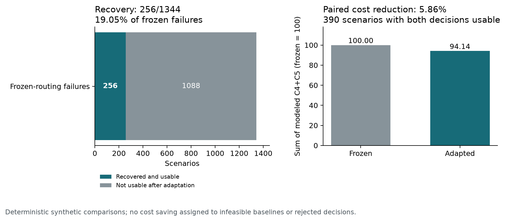
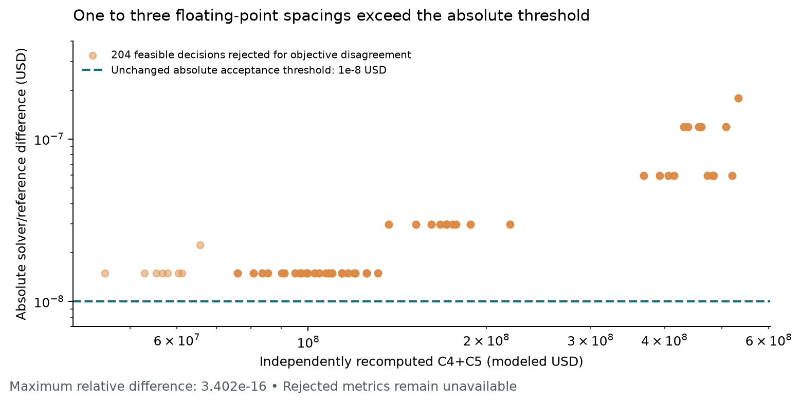

# Adapting routing under changing demand

Stage 1 selects a deployment. Stage 2 asks a different question: can that same
deployment serve a changed workload by adjusting routing and unmet demand?
The October 13 campaign tests this boundary and preserves its failures as well
as its usable decisions. It measures synthetic allocation software on a CPU.

## What was executed

The [prepared campaign](NIGHTLY_CAMPAIGN.md) contributes forty Stage-1 sources:
four query/model/tier shapes, two synthetic load factors, GH and P_DM once,
and AGH with seeds 37/41/43. Each accepted source retains its deployment over
fifty deterministic arrival/adverse-factor combinations. The original unmet
caps, LP, coherent units and numerical acceptance policy remain fixed.

| Boundary | Recorded count |
|---|---:|
| Completed workers | **40/40** |
| Independently accepted Stage-1 sources | **37/40** |
| Skipped scenarios after three rejected sources | **150** |
| Attempted operational LPs | **1,850** |
| Scientifically usable operational decisions | **646** |
| Solver-infeasible LPs | **1,000** |
| Optimal LPs rejected for objective disagreement | **204** |


A completed worker is not an accepted fifty-point grid. No source has fifty
usable LPs, so there is no complete-grid mean cost or service result. The grid
is a declared project sensitivity study, not the paper's sampled 500 scenarios,
its separate 2% unmet-cap experiment, or a probability model for production traffic.

The primary run restarted from zero with AC power observed before launch and
at all six later observations. Forty worker wall durations sum to **659.521 s
(10.992 min)**, excluding coordinator/reporting overhead. Integrated Stage-2
duration has median **39.86 ms**, Q1 **25.23 ms**, Q3 **64.15 ms** across different
scenarios; this is not repeated timing of one LP. Gurobi 13.0.3, Python 3.14.3,
Pyomo 6.10.0 and the Balanced power plan are recorded. The earlier battery-start
attempt was excluded from the primary analysis and remains preserved locally.

## Two measured benefits, with their denominators

Frozen nominal routing fails independent validation in **1,344** scenarios.
Operational adaptation produces a usable decision in **256** of them:

```text
recovery = recovered usable decisions / frozen-routing failures
         = 256 / 1344 = 19.0476%
```

This is a recovery fraction over a deterministic synthetic grid, not a
real-world success probability. Scenarios rejected for numerical disagreement
remain excluded even when their constraints are feasible.

For cost, compare only the **390 scenarios where both frozen and adapted
decisions are usable**. On this identical paired subset, summed operational
`C4+C5` falls from 10,547,532,668.8 to 9,929,719,445.12 modeled USD:

```text
paired reduction = (sum frozen C4+C5 - sum adapted C4+C5) / sum frozen C4+C5
                 = 5.8574%
```

These sums pool separate synthetic scenarios; they are not a cloud bill or a
typical instance's saving. The large load factor dominates their magnitude.
An infeasible frozen baseline receives no numerical cost-saving claim.



| Method | LP attempts | Usable | Frozen failures | Recovered | Usable pairs | Paired reduction |
|---|---:|---:|---:|---:|---:|---:|
| GH | 400 | 126 | 286 | 41 | 85 | 6.0991% |
| AGH | 1,200 | 378 | 858 | 123 | 255 | 6.0991% |
| P_DM | 250 | 142 | 200 | 92 | 50 | 0.0000% |

This table documents coverage, not a method ranking. AGH has three source seeds
per shape/load; GH and P_DM have one. Rejected P_DM sources also change its
scenario cohort. Cross-method cost averages over those different accepted
subsets would not establish superiority.

## Why 204 optimal solver outputs were rejected

All 204 cases occur at synthetic load factor 100000. Gurobi reports an optimum
and the independent validator accepts the constraints, but the separately
recomputed `C4+C5` differs from the solver's objective by more than the existing
**1e-8 USD absolute agreement threshold**.

One recorded example is 76,006,408.80000001 from the solver versus 76,006,408.8
from the reference, a difference of **1.4901161193847656e-8 USD**. Across the
204 cases, differences are one to three floating-point spacings at the
objective's scale. The maximum absolute difference is **1.7881393432617188e-7
USD** and maximum relative difference **3.401745961429846e-16**.



These magnitudes are consistent with floating-point evaluation roundoff.
They do not turn the rejected decisions into usable results under the current
policy. The campaign keeps all 204 rejections, with no repaired decisions,
relaxed threshold, or cost/service metrics for them. Constraint feasibility,
solver optimality and objective agreement answer distinct questions.

The three rejected high-load P_DM sources are separate:

| Source | Independent rejection evidence |
|---|---|
| 16x4x4 | Error-SLO constraint fails; objective also differs by 1.4901161193847656e-8 USD. |
| 32x4x4 | Constraints pass; objective differs by 2.9802322387695312e-8 USD. |
| 16x8x8 | Demand balance fails; objective agrees exactly. |

All eight Stage-1 P_DM solves finish with time-limited feasible incumbents,
not proven optima. Five pass scientific acceptance. A future scale-aware
numerical policy would be a separate experiment; the current evidence retains
the original policy and rejections.

## Inspect and reproduce the evidence

The [dataset guide](../benchmarks/stage2_stress_2026-10-13/README.md) explains
archive verification and a solver-free replay using the exact frozen scientific
sources. Fresh post-run replay reproduces forty Stage-1 validation reports,
1,850 frozen-routing reports, all 850 extracted operational reports (including
the 204 numerical rejections), and every usable objective/service indicator.
All **1,970 job-file SHA-256 hashes** match the execution inventory.

- [Analysis JSON](../benchmarks/stage2_stress_2026-10-13/analysis/analysis.json)
  retains per-source and per-shape/load/method counts and timing scopes.
- [Scenario CSV](../benchmarks/stage2_stress_2026-10-13/stress_scenarios.csv)
  retains all 1,850 attempts and leaves rejected metrics empty.
- [Numerical diagnostics](../benchmarks/stage2_stress_2026-10-13/analysis/numerical_diagnostics.json)
  identifies every objective rejection and its recorded difference.
- [Complete evidence archive](../benchmarks/stage2_stress_2026-10-13/evidence.zip)
  retains source inputs, solver statuses, solutions, validation reports and logs.

The [larger-instance timing study](PERFORMANCE.md) remains a separate measured
campaign: C++/OpenMP speedups do not describe this Python operational LP.
